# Portvakt

Portvakt is a multi-tenant identity broker for Swedish public-sector organisations and their
services. Upstream identity providers authenticate people (Entra ID for employees; BankID, Freja
eID and SITHS through OIDC brokers or SAML IdPs of the Swedish eID Framework); Portvakt
federates them, applies each tenant's policy and issues OpenID Connect tokens, one issuer per
tenant, to the organisation's own applications.

Version 1.0.0. MIT licensed.

## Features

- **OpenID Connect provider per tenant** (`oidc-provider`, OpenID Certified): authorization code
  with PKCE, refresh token rotation bound to the broker session, client_credentials between
  applications, PAR, introspection and revocation; access tokens are short-lived ES256 JWTs for
  one application.
- **Upstream federation**: any OIDC provider (Entra ID including multi-tenant issuers, Criipto,
  Signicat) and SAML 2.0 following the Swedish eID Framework (signed requests, encrypted and
  signed assertions, levels of assurance, entity categories, PrincipalSelection, metadata
  refresh with signature checks, single logout).
- **Policy**: levels of assurance with step-up (`acr_values`), session lifetimes per login
  method (maximum age, idle timeout, single sign-on allowed or not), home realm discovery.
- **People and roles**: persons created at first login, identities linked by personal identity
  number between methods that prove it, roles from assignments and upstream group rules,
  per-application attributes, protected identity handled throughout.
- **Representation (ombud)**: a person acts for an organisation or another person; the choice is
  re-checked at every refresh and revocation ends the tokens.
- **Administration**: admin API v1 (OpenAPI) and an admin portal; platform and tenant
  administrators, kill switches that end sessions at once, a complete audit trail.
- **SDKs**: TypeScript for Node and Express ([`@portvakt/sdk-node`](packages/sdk-node)) and Java 21
  with a Spring Boot 4.1 starter ([`sdk-java`](sdk-java)): BFF login, API token validation,
  service tokens, step-up, representation.
- **Operations**: rate limits, strict security headers, JSON logs without personal data,
  Prometheus metrics, health probes, graceful shutdown, scheduled and emergency key rotation,
  encrypted secrets and personal identity numbers at rest, container images, a Helm chart and
  Docker Compose files.

## Architecture

```mermaid
flowchart LR
  browser([Browser]) --> apps[Applications<br/>BFF with the SDK]
  apps -- OIDC: code, refresh, JWKS --> portvakt
  browser -- login UI --> portvakt[Portvakt<br/>issuer per tenant<br/>/t/&#123;tenant&#125;]
  portvakt -- OIDC / SAML --> idps[Upstream IdPs<br/>Entra ID, BankID, Freja, SITHS]
  admin[Admin portal] -- admin API --> portvakt
  portvakt --- db[(PostgreSQL)]
  apps -- access token --> apis[APIs]
```



Details: [docs/architecture.md](docs/architecture.md).

## Quick start

Requirements: Node 24, npm 11, Docker (for Postgres; the Java SDK builds in a container).

```sh
npm install
npm run dev:stack
```

`dev:stack` starts Postgres, migrates, builds the UIs, and runs the mock IdPs (:4500), a seeded
`demo` tenant, Portvakt (:3000), the demo service as Tjänst A (:3100) and Tjänst B (:3200) and the
admin portal (:3400). Open http://localhost:3100 and sign in with a mock persona; the admin portal
is at http://localhost:3400/t/system/ (persona `erik-admin`, Mock Entra). Ctrl+C stops it.

To try the production images instead: `npm run compose:local` (the same stack in containers),
`npm run compose:local:down` to remove it.

Checks: `npm run typecheck`, `npm run lint`, `npm test` (needs `npm run db:up`), `npm run
test:e2e` (the Playwright suite over the whole stack), `npm run test:e2e:compose` (the same
against the production images), `npm run test:java`, `npm run helm:check`. [CLAUDE.md](CLAUDE.md)
is the contributor's reference for the repository.

## Documentation

| Document                                                                                     | Contents                                                                          |
| -------------------------------------------------------------------------------------------- | --------------------------------------------------------------------------------- |
| [docs/architecture.md](docs/architecture.md)                                                 | Components, flows (login, SSO, representation, step-up, logout, keys), data model |
| [docs/integration.md](docs/integration.md)                                                   | How an application integrates: registration, SDKs, claims, service tokens         |
| [docs/claims.md](docs/claims.md)                                                             | The claims contract (v1)                                                          |
| [docs/login-methods.md](docs/login-methods.md)                                               | Configuring Entra ID, Criipto/Signicat and Swedish eID Framework IdPs             |
| [docs/operations.md](docs/operations.md)                                                     | Deployment (Helm, Compose), configuration reference, runbooks                     |
| [docs/admin-api.md](docs/admin-api.md)                                                       | Admin API v1                                                                      |
| [docs/threat-model.md](docs/threat-model.md)                                                 | Threats, mitigations and residual risks                                           |
| [packages/sdk-node/README.md](packages/sdk-node/README.md)                                   | TypeScript SDK manual                                                             |
| [sdk-java/README.md](sdk-java/README.md)                                                     | Java SDK and Spring Boot starter manual                                           |
| [CHANGELOG.md](CHANGELOG.md), [SECURITY.md](SECURITY.md), [CONTRIBUTING.md](CONTRIBUTING.md) | Releases, vulnerability reporting, contributing                                   |

## Repository

| Path                     | Contents                                     |
| ------------------------ | -------------------------------------------- |
| `apps/server`            | The broker                                   |
| `apps/login`             | Login UI (React), served by the broker       |
| `apps/admin`             | Admin portal (BFF and React SPA)             |
| `apps/mock-idp`          | Mock upstream IdPs for development and tests |
| `packages/sdk-node`      | TypeScript SDK                               |
| `packages/http-kit`      | Shared HTTP hardening and observability      |
| `packages/design-system` | The design system of every UI                |
| `sdk-java`               | Java SDK and Spring Boot starter             |
| `examples`               | Demo services (TypeScript and Java)          |
| `e2e`                    | Playwright end-to-end suite                  |
| `deploy`                 | Dockerfile, Compose files, Helm chart        |
| `docs`                   | Documentation                                |
