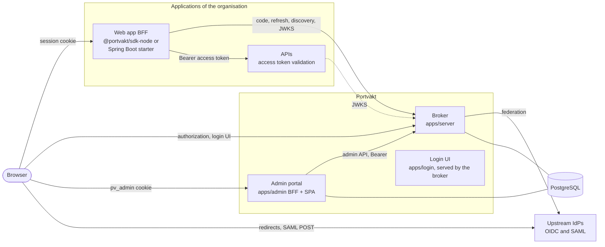
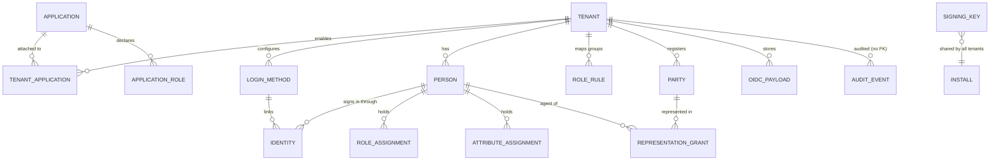
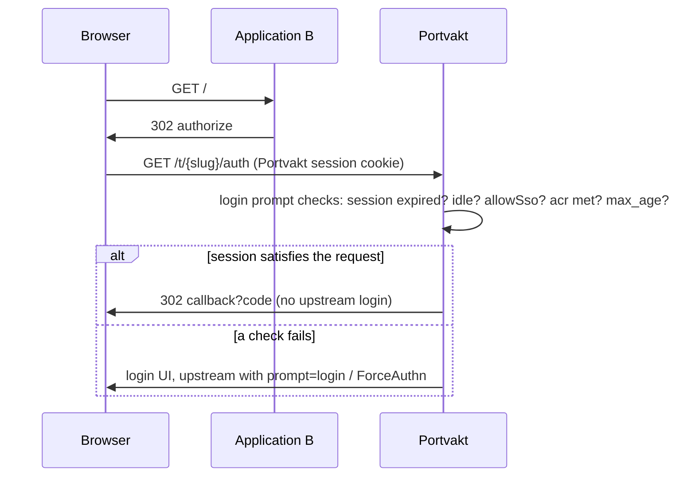
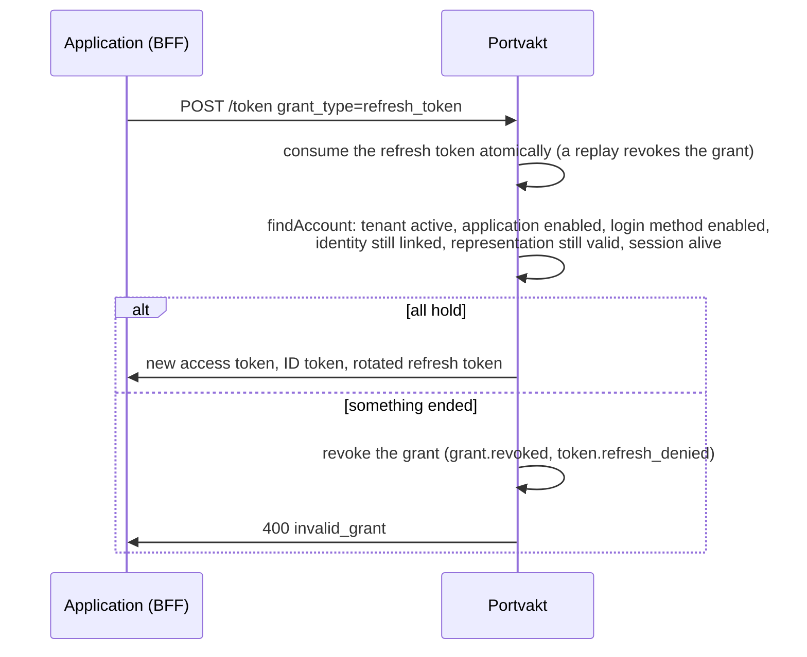
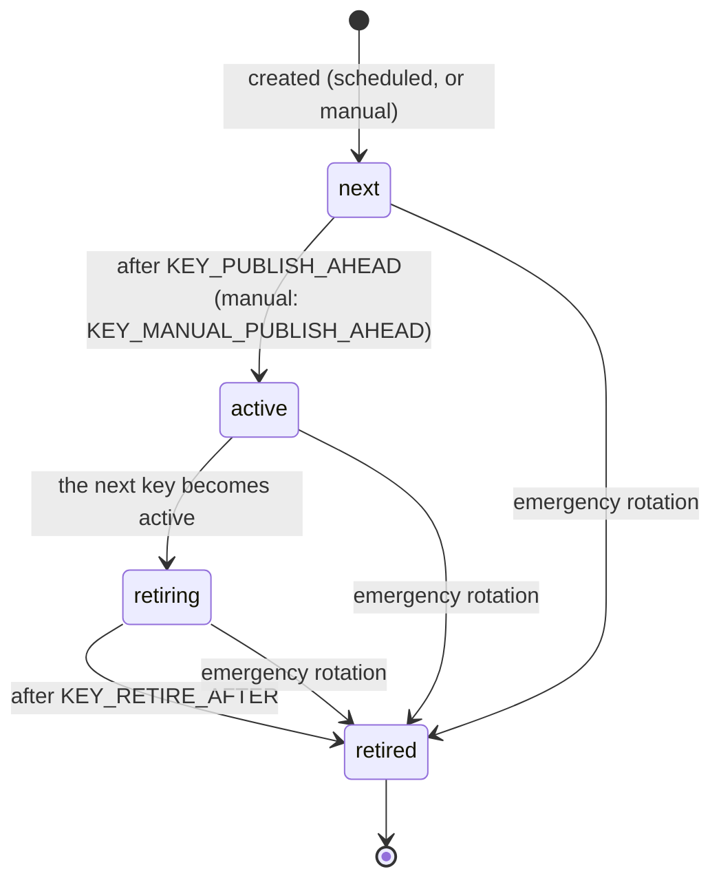

# Architecture

Portvakt is an identity broker. Upstream identity providers (Entra ID, BankID and Freja brokers,
SITHS IdPs) authenticate people; Portvakt federates them, applies the tenant's policy
(assurance levels, session lifetimes, single sign-on, representation) and issues OIDC tokens to
the organisation's own applications. The fixed decisions behind it are in [plan.md](plan.md),
the token contents in [claims.md](claims.md), operations in [operations.md](operations.md) and
the threat analysis in [threat-model.md](threat-model.md).

## Components



| Component         | Code                                        | Role                                                                                        |
| ----------------- | ------------------------------------------- | ------------------------------------------------------------------------------------------- |
| Broker            | [`apps/server`](../apps/server)             | One OIDC provider per tenant (`oidc-provider`), federation, admin API, jobs                 |
| Login UI          | [`apps/login`](../apps/login)               | React SPA: method choice, representation chooser, errors, logout; served by the broker      |
| Admin portal      | [`apps/admin`](../apps/admin)               | BFF on the TypeScript SDK and a SPA; an ordinary application of Portvakt (`portvakt-admin`) |
| TypeScript SDK    | [`packages/sdk-node`](../packages/sdk-node) | BFF login, access token validation, service tokens for Express                              |
| Java SDK          | [`sdk-java`](../sdk-java)                   | The same for Java 21 and Spring Boot 4.1                                                    |
| Shared HTTP layer | [`packages/http-kit`](../packages/http-kit) | Metrics, request context (traceparent), rate limiter, security headers                      |
| Mock IdPs, demos  | `apps/mock-idp`, `examples/*`               | Development and tests only                                                                  |

Inside the broker ([`server.ts`](../apps/server/src/server.ts) is the composition root):

- **HTTP layer** ([`app.ts`](../apps/server/src/app.ts)): request context and logging, metrics by
  route template, security headers, health probes, URL and body limits, rate limits
  ([`http/rate-limits.ts`](../apps/server/src/http/rate-limits.ts)).
- **Tenant routing** ([`oidc/routes.ts`](../apps/server/src/oidc/routes.ts)): `/t/{slug}/*` goes to
  that tenant's provider, built lazily and cached by the `ProviderRegistry`
  ([`oidc/registry.ts`](../apps/server/src/oidc/registry.ts)); Host and forwarded headers are
  pinned to `PUBLIC_URL` first.
- **Provider configuration** ([`oidc/provider.ts`](../apps/server/src/oidc/provider.ts)): claims
  ([`oidc/claims.ts`](../apps/server/src/oidc/claims.ts)), session policy checks, refresh
  re-validation (`findAccount`), the representation prompt, and the Postgres adapter
  ([`oidc/adapter.ts`](../apps/server/src/oidc/adapter.ts)).
- **Login flow** ([`login/routes.ts`](../apps/server/src/login/routes.ts)) and **federation**
  ([`federation/service.ts`](../apps/server/src/federation/service.ts); OIDC upstream in
  [`federation/upstream.ts`](../apps/server/src/federation/upstream.ts), SAML in
  [`federation/saml/`](../apps/server/src/federation/saml)).
- **Representation** ([`representation/`](../apps/server/src/representation)), **keys**
  ([`keys/`](../apps/server/src/keys)), **audit** ([`audit/`](../apps/server/src/audit)),
  **admin API** ([`admin/api/`](../apps/server/src/admin/api)), **outbound guard** for every
  configured URL ([`net/outbound.ts`](../apps/server/src/net/outbound.ts)).
- **Jobs** under advisory locks ([`jobs/`](../apps/server/src/jobs)): key rotation, payload
  cleanup, SAML metadata refresh; they run on one replica at a time.

## Multi-tenancy

Every install is multi-tenant; a single organisation is an install with one tenant.

- Each tenant has its own issuer `{PUBLIC_URL}/t/{slug}`, its own provider instance, cookies
  scoped to `/t/{slug}` and storage scoped by `tenant_id`. A suspended or unknown tenant answers 404.
- **Applications** are registered once per install (client id, client authentication, redirect
  URIs, declared roles and attribute keys, allowed extra scopes, representation mode, service
  audiences) and **attached** to tenants. Only an application enabled in a tenant can
  authenticate there. Enabling a second application in a tenant gives single sign-on between
  them.
- **Login methods**, **persons**, **roles**, **rules**, **attributes**, **parties** and
  **representation grants** belong to one tenant; every tenant-scoped table carries `tenant_id`
  and references other rows through composite `(tenant_id, id)` foreign keys, and every
  repository method takes the tenant explicitly.
- **Signing keys** are shared by all tenants. A token's tenant is proven by its `iss`, which
  every verifier pins (both SDKs, the admin API). Per-tenant keys are a recorded follow-up.
- The `system` tenant hosts platform administration (the admin portal's `platform-admin` role).

## Data model



The schema is in [`apps/server/migrations`](../apps/server/migrations). Notable choices:

- Secrets and personal identity numbers at rest are SecretBox envelopes (AES-256-GCM under
  MASTER_KEY, bound to their row by a context string such as `identity:<id>:pin`); equality
  lookups use HMAC blind indexes ([`crypto/`](../apps/server/src/crypto)).
- `oidc_payloads` holds oidc-provider's sessions, interactions, grants, codes and refresh
  tokens, plus Portvakt's own login state: the session record (latest login of a browser
  session, its policy, its upstream SAML sessions) and the grant login (the login one
  application's grant was issued for). Single use (codes, refresh tokens) is an atomic `UPDATE
... WHERE consumed_at IS NULL`.
- `federation_states` holds upstream OIDC and SAML state (hashed state, encrypted PKCE verifier,
  nonce, AuthnRequest id), each consumed once; `saml_replay_cache` holds assertion ids.
- `audit_events` is append-only (runtime role: SELECT and INSERT; a trigger refuses UPDATE and
  DELETE except through the retention function) and has no foreign key to tenants, so the trail
  outlives a deleted tenant.
- Repositories emit a change notification (`NOTIFY portvakt_changes`) inside the transaction
  that changes a tenant, an application's client configuration, an attachment, a login method or
  a key state; every replica rebuilds the affected providers and reloads keys.

## Flows

### OIDC login (upstream OIDC)

```mermaid
sequenceDiagram
  autonumber
  participant B as Browser
  participant A as Application (BFF)
  participant P as Portvakt /t/{slug}
  participant U as Upstream IdP (OIDC)
  B->>A: GET /protected
  A->>B: 302 authorize (PKCE, state, nonce)
  B->>P: GET /t/{slug}/auth
  P->>B: 302 /t/{slug}/interaction/{uid}
  B->>P: login UI: choose a method (or one method / home realm: straight on)
  P->>B: 302 upstream authorize (state, PKCE, nonce; acr_values, prompt=login when needed)
  B->>U: authenticate
  U->>B: 302 /t/{slug}/federation/{methodId}/callback?code
  B->>P: callback: state consumed once, code exchange, ID token validation, claim mapping, JIT person
  P->>B: 302 .../interaction/{uid}/federation/complete?ref (completion consumed once)
  P->>P: session record, roles, attributes, consent check stores the grant login
  P->>B: 302 application callback?code
  A->>P: POST /t/{slug}/token (code, PKCE, client auth)
  P->>A: ID token, access token, refresh token
  A->>B: session cookie, 302 /protected
```

The interaction cookie is scoped to the interaction path and never reaches the upstream callback,
which is why the completion hop exists. Every failure ends in a login UI error view and a
`login.failure` audit event. Code: [`login/routes.ts`](../apps/server/src/login/routes.ts),
[`federation/service.ts`](../apps/server/src/federation/service.ts),
[`oidc/interactions.ts`](../apps/server/src/oidc/interactions.ts).

### SAML login (Swedish eID Framework)

The upstream hop is a SAML exchange instead: Portvakt sends a signed AuthnRequest (HTTP-Redirect,
or HTTP-POST through `/t/{slug}/saml/{id}/post`) with RequestedAuthnContext for the method's
levels of assurance (and PrincipalSelection at a step-up), and the IdP posts the Response to the
ACS `/t/{slug}/saml/{id}/acs`. The ACS correlates by RelayState and InResponseTo (no cookie
arrives cross-site), verifies the Response and assertion signatures with an algorithm allowlist
and signature-wrapping rules, decrypts the assertion, checks audience, recipient, destination,
times, the returned level and the assertion id (once), maps the attributes and continues with the
same completion hop. Each login method is its own SP (`/t/{slug}/saml/{id}`, metadata at
`.../metadata`). Code: [`federation/saml/service.ts`](../apps/server/src/federation/saml/service.ts),
[`federation/saml/xml.ts`](../apps/server/src/federation/saml/xml.ts); configuration in
[login-methods.md](login-methods.md).

### Single sign-on and session policy



The broker session lasts at most the login method's `maxAgeSeconds`; without an authorization or
refresh within `idleSeconds` it requires a login; with `allowSso = false` another application
needs a fresh upstream login. Applications may tighten (`max_age`, `prompt=login`,
`acr_values`), never loosen. Each application's grant keeps the claims of the login it was issued
for. Code: the login prompt checks in [`oidc/provider.ts`](../apps/server/src/oidc/provider.ts),
[`oidc/session-policy.ts`](../apps/server/src/oidc/session-policy.ts).

### Representation (ombud)

After the login, an application whose `representationMode` is `optional` or `required` gets the
chooser (oidc-provider's `select_account` prompt, [`oidc/representation-prompt.ts`](../apps/server/src/oidc/representation-prompt.ts)):
the person picks "myself" or a party they hold a valid right for in this application. The
chooser never receives a full personal identity number; the POST names a party id that is looked
up again. The choice is stored in the application's grant login; tokens carry `rep` with the
party id. At every refresh `findAccount` re-validates the right (not revoked, within its window,
covering the application, the application enabled); otherwise the grant is revoked and the
refresh fails. A different choice replaces the grant, so old refresh tokens never switch
representation. Rights come from `RepresentationSource`s merged per tenant
([`representation/registry.ts`](../apps/server/src/representation/registry.ts)); v1 has the
internal register.

### Step-up

An application asks for a higher level with `acr_values` (or for a fresh login with `max_age`)
while the person is signed in. The login prompt fails with `acr_not_met`, the login UI offers
only methods that satisfy the request, and Portvakt names the person upstream when it can (SAML
PrincipalSelection; an OIDC `login_hint` with the personal identity number only through PAR).
The new login must resolve to the same person, otherwise `step_up_person_mismatch` and nothing
changes. The higher acr applies to this application's grant; the session record follows the
latest login, so its method's policy governs the session from then on. Code: `isStepUp` in
[`oidc/interactions.ts`](../apps/server/src/oidc/interactions.ts).

### Token refresh



Refresh tokens are bound to the broker session and rotate on every use; they live at most
`min(idleSeconds, session end)`. Both SDKs refresh under a per-session lock when less than half
the access token's lifetime (at most their default minimum) is left.

### Logout and single logout

RP-initiated logout (`/t/{slug}/session/end` with `id_token_hint`) ends the broker session and its
grants. When the session's logins went through SAML IdPs, Portvakt then sends a LogoutRequest to
each IdP in turn (HTTP-Redirect or POST) and finally returns to the application's
`post_logout_redirect_uri`; a failing IdP never blocks the local logout. An IdP-initiated
LogoutRequest (signed, its Destination the SP's SLO URL, fresh, its id accepted once) ends every
broker session that holds that upstream session, and gets a signed LogoutResponse. The session
record keeps each upstream session's NameID and SessionIndex only as blind indexes plus sealed
values. Code: [`federation/saml/service.ts`](../apps/server/src/federation/saml/service.ts),
the `upstreamLogout` hook in [`oidc/provider.ts`](../apps/server/src/oidc/provider.ts).

Administrators have kill switches that end sessions and grants at once (tenant suspension,
application disable per tenant or globally, detach, login method disable or delete, identity
unlink, person delete, end-sessions): [admin-api.md](admin-api.md).

### Key rotation



JWKS publishes `next`, `active` and `retiring` keys, so a key is known to verifiers before it
signs and stays verifiable until the longest token and session have ended. The rotation job runs
under an advisory lock; transitions are time-guarded in SQL; every replica reloads keys on the
change notification. A manual rotation publishes the new key at once and arms a timer on every
replica for its activation. An emergency rotation generates a fresh key, activates it and retires
all others in one transaction. Code: [`keys/rotation.ts`](../apps/server/src/keys/rotation.ts),
[`keys/key-cache.ts`](../apps/server/src/keys/key-cache.ts); procedures in
[operations.md](operations.md#signing-keys).

## Admin

The admin portal is an application of Portvakt itself (client `portvakt-admin`, roles
`platform-admin` in the `system` tenant and `tenant-admin` in any tenant that self-administers).
Its BFF keeps one SDK client per tenant issuer and proxies `/t/{slug}/api/*` to the admin API
with the session's access token. The admin API ([admin-api.md](admin-api.md)) verifies the token
against the issuer of its `tid`, intersects its roles with the live assignments, scopes tenant
administrators to their tenant and audits every change. The first platform administrator comes
from the bootstrap ([operations.md](operations.md#bootstrap)).

## Deployment

Containers ([`deploy/Dockerfile`](../deploy/Dockerfile)), a Helm chart
([`deploy/helm/portvakt`](../deploy/helm/portvakt)) and Docker Compose files
([`deploy/`](../deploy)); see [operations.md](operations.md). The broker is stateless apart from
Postgres; any number of replicas run side by side, jobs coordinate through advisory locks and
configuration changes propagate through LISTEN/NOTIFY.
